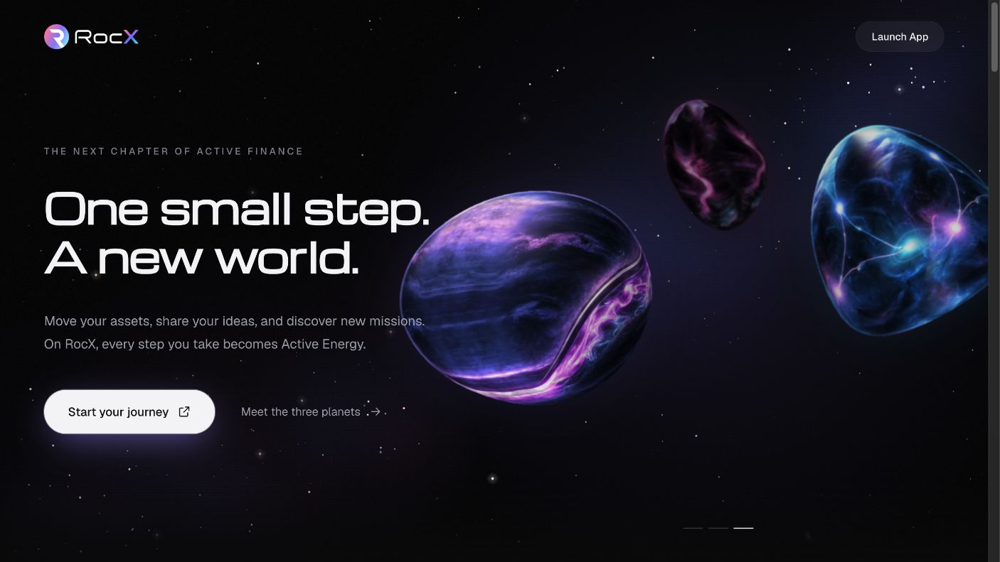
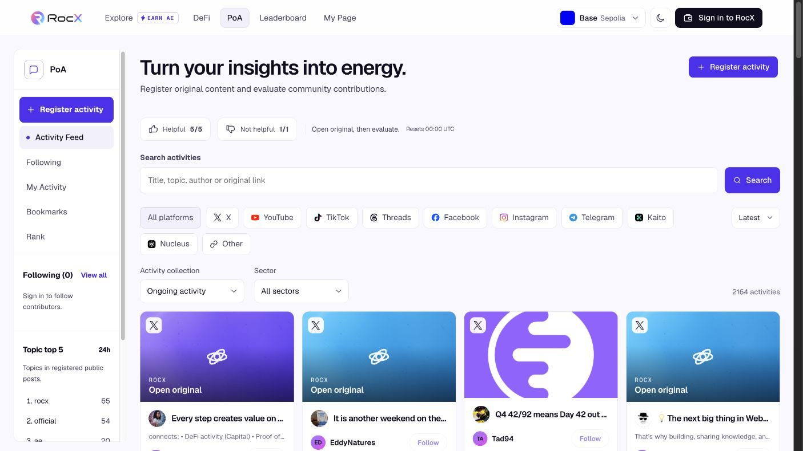
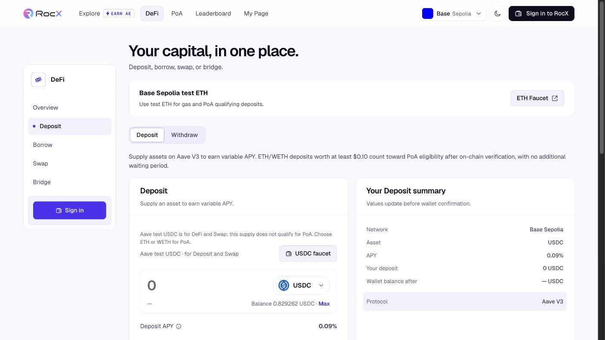

<h1 align="center">RocX</h1>

<strong>The Reputation Layer for Web3 Work</strong>

Public product, architecture, and integration documentation.

  <a href="https://rocx-testnet.com">Website</a> ·
  <a href="https://docs.rocx.io">Product docs</a> ·
  <a href="mailto:dev@rocx.io">Contact the team</a>

The existing RocX testnet is the starting point for the reputation layer.

## What RocX is building

RocX connects activity, contribution evidence, and work outcomes for **people and agents**. The goal is to help projects select relevant providers and let external products use the same reputation evidence.

The application provides the starting activity records. The planned reputation layer adds context, review history, and reusable assessments.

## See the product

<table>
  <tr>
    <th width="50%">PoA contributions</th>
    <th width="50%">DeFi activity</th>
  </tr>
  <tr>
    <td></td>
    <td></td>
  </tr>
  <tr>
    <td>Original posts, source links, categories, and community feedback.</td>
    <td>Supported testnet interactions and activity context.</td>
  </tr>
</table>

Screenshots from the public testnet, November 13, 2026. **[Open the full product tour](docs/product-overview.md)** for larger views and feature context.

## Read the documentation

| Start with | Read next |
| --- | --- |
| [Product overview](docs/product-overview.md) — users and use cases | [Reputation model](docs/reputation-model.md) — evidence and assessment |
| [Architecture](docs/architecture.md) — system and work flows | [Integration direction](docs/integrations.md) — API, MCP, SDK, and ERCs |
| [Roadmap](docs/roadmap.md) — delivery sequence | [Working with RocX](docs/collaboration.md) — partner collaboration |

## Current status

**Testnet foundation**  
PoA contributions, community feedback, linked accounts, supported DeFi activity, and Explore missions.

**In development / planned**  
Context-specific reputation, KOL and agent matching, evaluated work and escrow, reputation API, read-only MCP, and SDK distribution.

This is a public product and architecture overview. Integration endpoints, packages, and contract deployments will be linked with their releases.

## Build with us

Describe the decision or workflow RocX could support in your product. For technical and partner discussions, contact **[dev@rocx.io](mailto:dev@rocx.io)**.

[Contributing](https://github.com/RocX-Network/.github/blob/main/CONTRIBUTING.md) · [Private security reporting](https://github.com/RocX-Network/.github/blob/main/SECURITY.md) · [X](https://x.com/RocX_official) · [Telegram](https://t.me/rocx_official)
