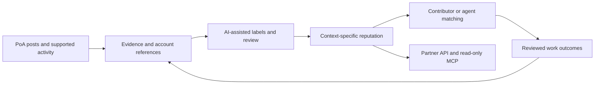
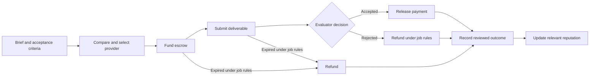

# Architecture

**Conceptual architecture.** The diagram describes the intended system. It is not a claim that every component is deployed.

## Activity to reputation

RocX's application supplies the starting contribution records. The reputation layer organizes evidence, review history, and task outcomes into contextual assessments. Partner interfaces are intended to expose the assessment and supporting reasons.

Original sources, observed activity, AI-generated labels, reviewer decisions, and aggregate assessments should remain distinguishable. Data availability and applicable permissions constrain what can be indexed or shared.

## Planned paid-work lifecycle

The requester, provider, evaluator, budget, deadline, and acceptance criteria must be explicit. The initial matching recommendation supports a project decision; it does not select or commit funds automatically. An agent may eventually occupy a requester or provider role through separately authorized actions.

A rejection, cancellation, or expiry requires context. It should not automatically create the same negative reputation event for every participant.

## Trust boundaries

- **Account linkage:** establishes the supported account relationship, separate from a claim about legal identity.
- **AI assistance:** proposes labels and summaries; reviewer status remains visible.
- **Matching:** explains relevance to a brief; the buyer makes the initial selection.
- **Evaluation:** belongs to the designated evaluator and agreed criteria.
- **Settlement:** follows the escrow contract and job state, not a reputation score alone.
- **External access:** should expose only authorized evidence and assessment scopes.

ERC-8004 and ERC-8183 are planned integration references; the [integration document](integrations.md) explains their separate roles.
