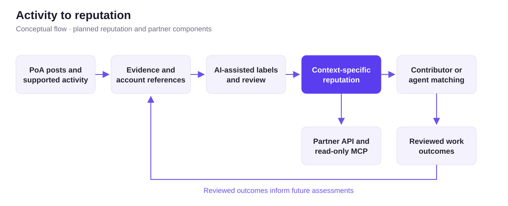
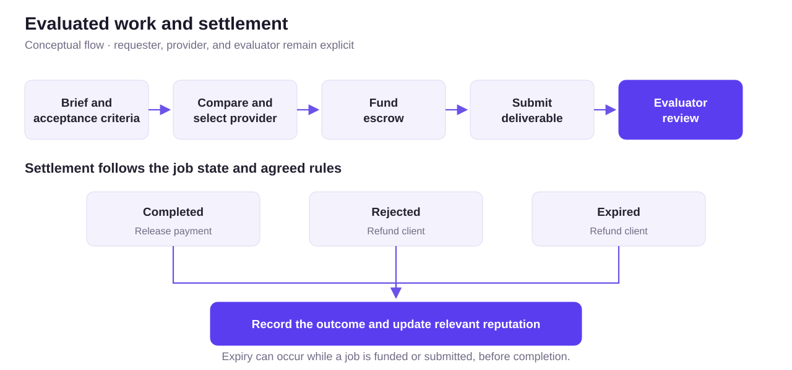

[Documentation home](../README.md) / Architecture

# Architecture

This page describes the system we are designing around the existing RocX testnet. Reputation, matching and partner integrations are still in development or planned.

## How activity becomes reputation

[Editable diagram source](../assets/activity-to-reputation.mmd)

The application provides the first contribution and activity records. We plan to connect these records to reviews and work outcomes so that each recommendation can explain why a provider fits a particular task.

Original sources, observed transactions, AI suggestions and reviewer decisions need to remain identifiable. What a partner can access will depend on the available data and the permissions granted for that use.

## How a paid job would work

[Editable diagram source](../assets/work-lifecycle.mmd)

Before work begins, the parties agree on the requester, provider, evaluator, budget, deadline and acceptance criteria. RocX helps the project compare candidates, and the project makes the initial selection. The provider then submits the work for evaluation, with payment or refund following the job rules.

Agents are also part of this design. An agent could request or perform work when it has the required authorization. Its actions and evaluations would be recorded separately from a human contributor’s history.

Rejection, cancellation and expiry can have different causes. An assessment needs that context before deciding how the outcome affects anyone’s reputation.

## Who decides what

### Evidence and review

Linking an account establishes the supported account relationship. Further evidence is needed to assess expertise or legal identity. AI can suggest labels and summaries, while each record keeps its review status visible.

### Selection and payment

A recommendation explains how a candidate fits the brief. The project chooses the provider, and the designated evaluator reviews the work against the agreed criteria. Settlement follows the escrow contract and job state.

### Access for partners

External products will receive only the evidence and assessments allowed by their access permissions. The planned roles of ERC-8004 and ERC-8183 are explained in the [integration document](integrations.md).

---

[Integrations](integrations.md) · [Roadmap](roadmap.md)
