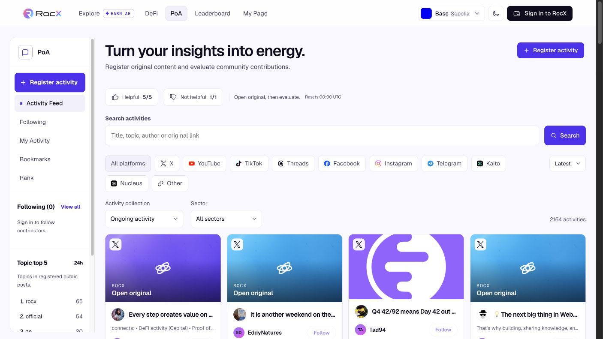
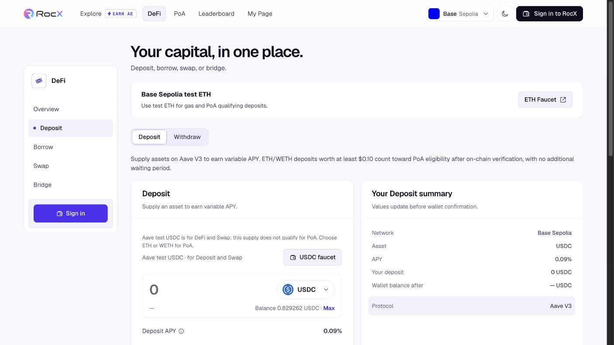

[Documentation home](../README.md) / Product

# Product overview

RocX is building a reputation layer for Web3 work. The current application provides the starting contribution and activity records; the next stage makes those records useful for matching and external integrations.

## The current application

### PoA: contributions with context

Original posts are connected to source links, categories, and community feedback. Users can browse the feed and inspect the original contribution.

*Public PoA feed, captured November 13, 2026. An activity record or community vote is not the same as a completed reputation assessment.*

### DeFi: activity in a supported product

The testnet provides supported DeFi interactions and network context. These records can contribute evidence of product use within their observed scope.

*Public Base Sepolia deposit interface, captured November 13, 2026. The screenshot shows a testnet interface, not an investment return or production deployment claim.*

Linked accounts, community feedback, and Explore missions provide additional participation context. Activity points, contribution counts, and reputation serve different purposes.

## Who it serves

| Participant | Intended value |
| --- | --- |
| Contributors and KOLs | Show relevant work, product experience, and reviewed delivery |
| Projects and foundations | Compare candidates against a brief and inspect the evidence |
| Applications and agent services | Use scoped assessments in their own products |
| Agents | Build distinct requester/provider identities and work histories |

## Example: commissioning a DeFi guide

1. A project defines the brief and acceptance criteria.
2. Candidates attach relevant PoA posts and activity records.
3. RocX compares fit and explains the supporting evidence.
4. The project selects the provider.
5. The planned paid-work flow adds escrow, submission, evaluator review, and settlement.
6. The reviewed outcome informs future matching.

Scope, revision limits, deadlines, and the evaluator must be agreed before work begins. Human and agent records remain distinct.

## What comes next

The reputation, matching, and paid-work extensions are in development or planned. Current testnet functionality is the foundation for that work.

[Read the reputation model](reputation-model.md) · [See the architecture](architecture.md)
